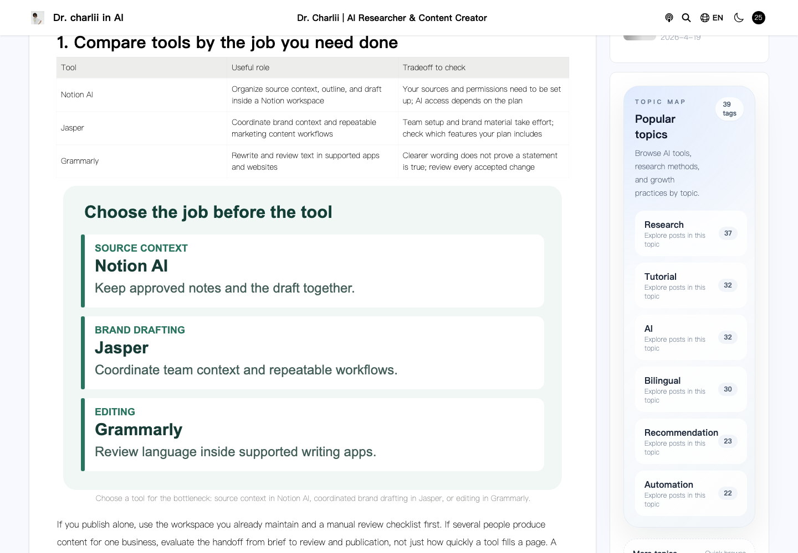
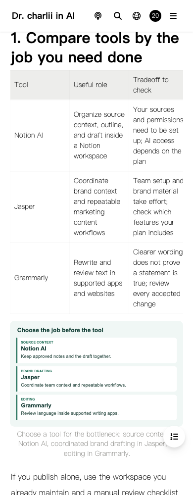

# Blog-writing guide update — 2026-10-26

Target: https://www.charliiai.com/en-US/article/best-ai-tools-blog-writing

The English article repeated the same three paragraphs across five sections, did not name any products, included an internal SEO-cluster note, and linked its supposed Chinese counterpart to itself. The replacement compares Notion AI for source context and workspace drafting, Jasper for shared brand context and marketing workflows, and Grammarly for rewriting and editing in supported apps. Recommendations reflect editorial workflow fit, not hands-on benchmarks, pricing guarantees, affiliate rankings, or ranking promises.

Official public sources checked on October 26, 2026:

- https://www.notion.com/help/notion-ai-faqs
- https://www.jasper.ai/
- https://www.grammarly.com/ai-writing-assistant
- https://developers.google.com/search/docs/fundamentals/using-gen-ai-content?hl=en

An obsolete Jasper blog-generator URL returned 404 and is excluded from citations. The main platform page was retrieved successfully and documents blog-post creation and shared brand context. Provider pages support product-feature descriptions; the workflow recommendations are editorial analysis. No new keyword volume or SERP research was used for this existing-page repair.

The article adds two comparison/revision tables, a reusable plain-text brief, an illustrative before/after editing example, three original explanatory SVGs, four visible FAQs, and a publishing checklist. The main next step is using the brief on one article; the existing newsletter form provides the return path. No new account, feature, event, subscription success, payment, or growth outcome is implied.

`lib/editorial/blog-writing.mjs` applies only to the exact English article ID, slug, and locale. It preserves the original publication date, updates the modification date, and supplies the same record map to HTML and Next navigation data. The distinct Chinese `/Tech/best-ai-tools-blog-writing` assets retain their prior hashes. FAQs remain in the body; FAQ rich-result eligibility is not claimed.

The release uses the accepted full Cloudflare Pages manifest plus two replaced English assets and three added SVGs, preserving the existing Functions bundle, routes, runtime, KV bindings, environment settings, sitemap, and all other asset hashes. This source snapshot cannot reconstruct the accepted production export; a full Next build is not claimed. Source remains on a review branch without merging.

Validation evidence is retained in the growth operations project under `data/charliiai-blog-writing-artifacts-20261026/`. Independent Chromium checks use GUI launchd, inspect desktop/mobile content, images, anchors, refresh, and client navigation, and verify the bytes actually delivered to the browser. API requests and selected analytics endpoints are intercepted. Some third-party advertising scripts may run unchanged; no claim is made that all telemetry is blocked. There are no real login, mail, payment, or image-generation actions.

Pre-change GSC windows, October 8–14 versus October 15–21: impressions 119→63, clicks 0→0, average position 12.5→18.6. These are pre-release observations and do not establish why the decline occurred. Review later complete comparable windows for impressions, CTR, clicks, ranking, and verifiable reader actions; do not attribute early changes to this release or expand the pattern without evidence.

Targeted ESLint and diff checks pass. A full-repository ESLint attempt was bounded to 45 seconds, timed out, and was terminated; it is not counted as a pass. No clean-CI or full-build claim is made.

## Production acceptance

Production deployment `a5e0b303-7f74-409e-9173-803f3496d031` passed desktop 1440px and mobile 390px browser checks and all 20 HTTP checks on the ordinary `www.charliiai.com` domain. The deployed preview passed the same checks before activation. The final audit confirmed the full 2,607-asset manifest, 2,602 unchanged existing asset hashes, unchanged Functions bundle and 12 routes, runtime, KV bindings, and complete preview/production settings. The 393-URL sitemap, Chinese counterpart, newsletter guide, and ComfyUI guide are preserved. Rollback baseline: `aea35b3b-15c2-4ab7-841a-0f901ef3a538`.

Checks covered hydration, a single H1, four body FAQs, both tables, decoded images and alt text, the reusable brief, TOC anchors, no global horizontal overflow, reload, and entering the revised page via Next router JSON. Production bytes were fetched remotely from the ordinary domain and relayed unchanged through the configured proxy; no local candidate was substituted. The first local desktop check used an incorrect table selector and failed. The corrected selector checks actual table elements; the complete checks were rerun, and the original failure is retained in operations evidence.

GSC accepted the sitemap submission with HTTP 204; readback returned pending with zero errors and warnings. IndexNow accepted the one updated URL with HTTP 200 using the existing public verification file. Neither response proves recrawl, indexing, or improved search performance.

Content commit: `44bfd06b8b5e6037bed71d1dddaf7ff1839372ea`. These acceptance notes and screenshots are a separate documentation commit in draft PR #12, targeting `fix/comfyui-guide-20261025`; it remains unmerged.

