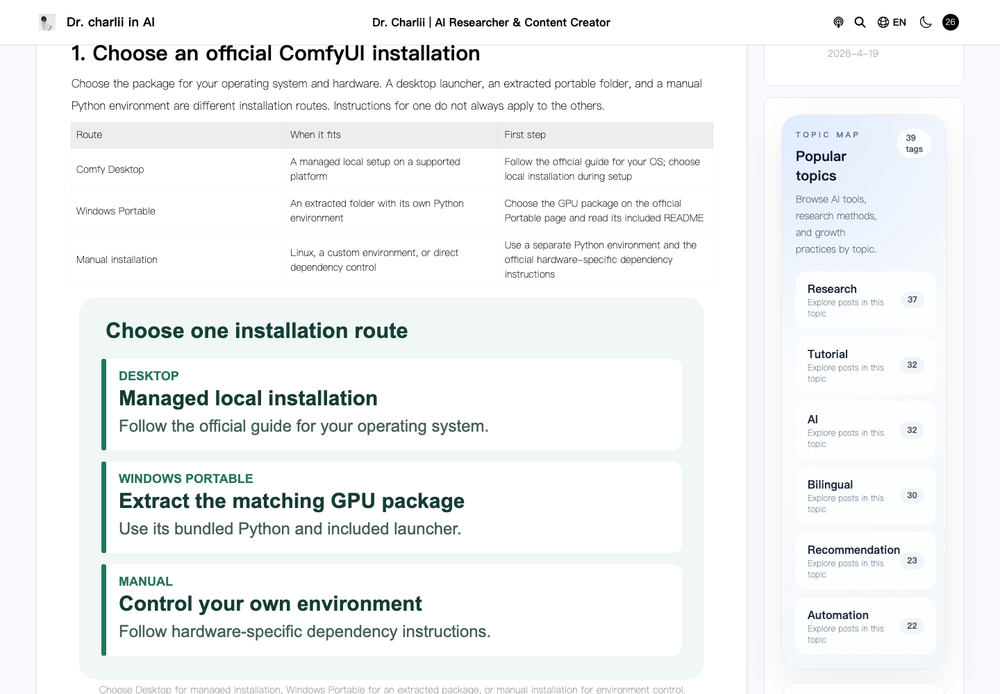
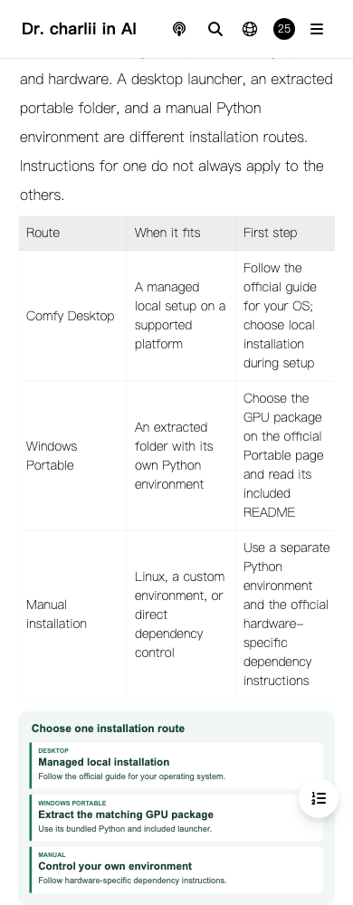

# ComfyUI beginner guide update — 2026-10-25

Target: https://www.charliiai.com/en-US/article/comfyui

The previous English article had about 315 words. It recommended a third-party integration pack without a verifiable package link and directed readers to a Baidu course link. It did not explain the checkpoint required by a first workflow, node inputs, or useful troubleshooting steps.

The replacement walks readers through official Desktop, Windows Portable, and manual installation routes; the official first-generation example and its checkpoint; the node graph; model-folder sharing; and common errors. It contains three comparison/troubleshooting tables, three original explanatory diagrams, a selectable YAML example, four FAQs, and official sources. The first useful action is to open the official beginner workflow, run it locally, and save a reusable JSON file. The existing newsletter subscription is the reader-return path.

Official public sources checked on 2026-10-25:

- https://docs.comfy.org/installation/desktop/windows
- https://docs.comfy.org/installation/desktop/macos
- https://docs.comfy.org/installation/comfyui_portable_windows
- https://docs.comfy.org/installation/manual_install
- https://docs.comfy.org/get_started/first_generation
- https://docs.comfy.org/basic-concepts/nodes
- https://raw.githubusercontent.com/Comfy-Org/ComfyUI/master/extra_model_paths.yaml.example

Hardware support and menu names vary by release; the article links to current official instructions rather than hardcoding GPU dependency versions. Desktop model management is distinguished from Portable/manual configuration. No fixed download price, speed benchmark, hands-on result, generated image, or traffic improvement is claimed. Two unsuccessful candidate source URLs returned 404 and are excluded. No new keyword volume research was used.

The editorial module applies only to the original English post ID and slug with locale en-US. The original publication date remains October 31, 2024. The Chinese /sharing/comfyui article and its navigation JSON are distinct assets and retain their previous hashes.

The production export is updated through the established guarded asset release: replace English HTML and navigation JSON from the same content module, add three SVGs, retain the complete existing manifest and Functions bundle. This avoids reconstructing a production export from a source snapshot that does not fully reproduce it. A full Next.js build is not a validation claim. The source branch is retained for review and is not merged automatically.

Validation records live in the growth operations project's data/charliiai-comfyui-artifacts-20261025 directory. They include source/locale isolation, HTML/navigation equality, original date retention, selected lint, browser hydration, tables, YAML, images, anchors, client navigation, and protected-route/configuration checks. Browser tests intercept API requests and selected analytics endpoints. Some advertising scripts run unchanged, so this does not claim that all third-party telemetry was blocked. No real sign-in, mail send, payment, or model generation was performed.

Measure later complete, comparable GSC windows for this URL and use the existing subscription funnel for reader conversion. No new analytics event or subscription outcome is fabricated by this release. Review impressions, CTR, clicks, and real subscription outcomes before repeating this page pattern.

## Production acceptance

Production deployment `aea35b3b-15c2-4ab7-841a-0f901ef3a538` passed 18 HTTP checks and browser checks at 1440px and 390px on the ordinary `www.charliiai.com` domain. The preview passed the same checks before activation. Production audit confirmed the complete 2,604-asset manifest, 2,599 unchanged baseline asset hashes, unchanged Functions bundle and 12 routes, runtime, KV bindings, and complete preview/production configuration. The 393-URL sitemap remains unchanged. The preceding newsletter deployment `5df64080-f557-4cc7-ad54-3e65f48dcc42` is the rollback baseline.

The browser checks verified hydration, a single H1, four FAQs, all three decoded illustrations, table-of-contents anchors, no global horizontal overflow, reload, and navigation from another article through the Next router. First-party response bytes were fetched remotely through the configured proxy and relayed unchanged to Chromium; target assets were checked against SHA256. Production tests used the ordinary domain, without substituting local candidates. HTTP checks independently verified response bytes and MIME types.

The two initial local viewport runs timed out while loading. Their failure records are retained in the operations project. After request diagnostics were added, local, preview, and production runs completed successfully at both widths. Each viewport ran separately to stay within the GUI runner's 180-second limit. Some passing cases recorded a third-party WebGL fallback warning; final production cases had no page errors or failed first-party assets.

Targeted ESLint, source isolation, content consistency, and diff checks passed. A full-repository lint attempt was stopped after a bounded 50-second timeout and is not counted as a pass; the process group was terminated. A full Next export and clean CI are not claimed. The source content commit is `05d767170a046f69dcbda8653ef33db9fdda8b5f`; acceptance notes and screenshots are a separate documentation change. Draft PR #11 targets `fix/newsletter-guide-20261025` and is not merged.

Pre-change search windows (October 8–14 versus October 15–21) show impressions 89→6, clicks 0→0, and average position 28.9→45.3. These values cannot measure this release. Review later complete windows before deciding whether to repeat this content pattern.

