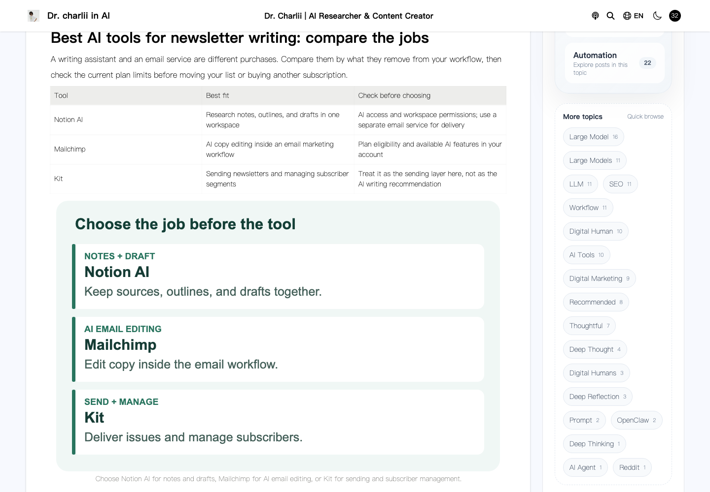
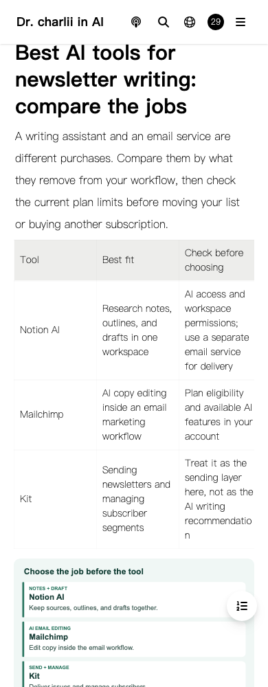

# Newsletter guide editorial update — 2026-10-25

Target: https://www.charliiai.com/en-US/article/best-ai-tools-newsletter-writing

The old guide repeated three paragraphs across five sections, contained an internal publishing note, and linked its purported Chinese companion back to the English article. Its title promised tool recommendations without comparing specific products.

The replacement compares Notion AI for workspace drafting, Mailchimp for AI email editing, and Kit for sending and subscriber management. Kit is explicitly identified as the delivery layer, rather than an AI writer. It includes a source-first prompt, an illustrative issue, pre-send checks, four FAQs, a table of contents, and three original explanatory diagrams. The booking example is an editorial exercise, not a customer case or measured result.

## Evidence and limits

Official public pages checked on 2026-10-25:

- https://www.notion.com/product/ai
- https://www.notion.com/help/notion-ai-faqs — summarizing, drafting, rewriting, tone/grammar assistance, plan and permission considerations.
- https://mailchimp.com/solutions/ai-tools/ — email generation, rewriting and polishing; eligibility varies.
- https://kit.com/features/email-marketing — newsletters, templates, segmentation, automations, and reporting.

No fixed prices, promised results, fabricated hands-on benchmarks, or unverified traffic figures are used. Two OpenAI pages returned 403 challenges and a beehiiv URL returned 404; none is used to support a recommendation. No new SERP or search-volume research was available for this edit.

The comparison window in the portfolio report precedes this update. Newsletter impressions had fallen from 162 to 67 with zero clicks in both windows; this identifies a page to investigate and does not prove that repeated copy caused the decline. Assess the update over later complete GSC windows.

## Source and release scope

`lib/editorial/newsletter.mjs` is the single source for content and metadata. It applies only to the existing Notion ID, the English slug, and the English locale. Route loaders pass the actual locale to `processPostData`; Chinese and other posts are left untouched. The original publication date is retained and the modification date reflects the edit.

The existing Chinese article lives at `/Tech/best-ai-tools-newsletter-writing`, with its own locale and content. It is not an English duplicate to overwrite. The broken paired link is removed from the English article.

For the production static export, the release transform uses the same content module and the existing Notion renderer to replace the English HTML and matching Next.js navigation JSON together. Three SVGs are added. The complete previous manifest, Functions routing/bundle, runtime configuration, headers, redirects, sitemap, and protected dashboard remain part of the release.

## Validation

The operations project stores machine-readable HTTP, browser, deployment, and configuration evidence under `data/charliiai-newsletter-artifacts-20261025/`. Browser checks cover desktop/mobile rendering, hydration, table-of-contents anchors, images, reload, and navigation through Next.js JSON. API writes and telemetry are intercepted during these browser checks. Real auth-session and protected-route HTTP responses are checked separately without signing in.

No full Next.js build is used for this release: the current source snapshot does not fully reconstruct the accepted production export. Local candidate tests, deployed preview tests, complete manifest/configuration comparisons, and ordinary production-domain checks gate activation. The source branch is retained for review; deployment is not a merge into the main branch.

Targeted ESLint covers every modified JavaScript file and both new modules. A repository-wide lint attempt was stopped after roughly six minutes without completing; it is not reported as a pass.

## Production acceptance

Production deployment `5df64080-f557-4cc7-ad54-3e65f48dcc42` passed 18 HTTP checks and browser checks at 1440px and 390px on the ordinary `www.charliiai.com` domain. The preview passed the same checks before activation. The two viewport tests ran separately to stay within this Mac's GUI runner time limit. Within each browser run, remote first-party responses were cached by URL and relayed unchanged; an independent HTTP check fetched current deployment bytes and verified MIME types. No browser page errors or failed first-party resources were recorded in the final production cases.

The first preview attempt hit a CDP response-body race, the second timed out waiting for the other article's client initialization, and a combined two-viewport run reached the GUI runner's 180-second limit. Hashing before response fulfillment, caching remote responses within a run, using client navigation for the related-article round trip, and splitting viewports produced complete passing evidence. Early failures remain in the operations artifacts.

